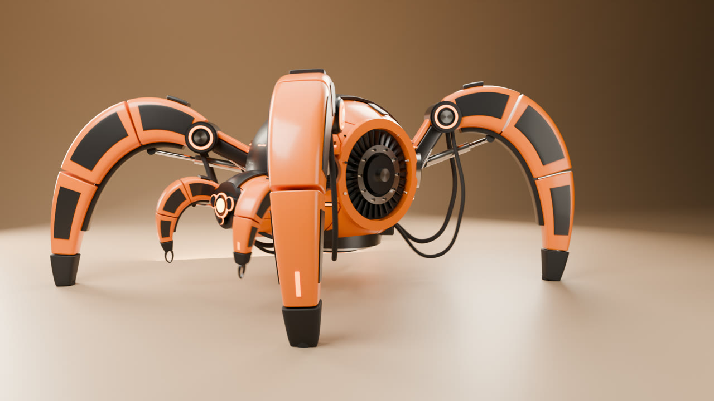

# blender-reference-build

A [Claude Code](https://claude.com/claude-code) skill that builds models in a **live Blender session through [MCP for Blender](https://github.com/ahujasid/mcp-for-blender)**, working from reference images and/or a production prompt.



## What it does

- **Connects** to Blender. When the add-on won't connect, it diagnoses the problem, including the stale-module-name trap in saved preferences.
- **Scopes the job first.** It picks one of three tiers, so rigging and rendering only happen when the brief asks for motion:
  - **Model**: model + stills
  - **Animation**: adds rig + motion
  - **Video**: adds the final rendered clip
- **Builds step by step** in the order a viewer can follow: blockout → secondary masses → hero feature → repeated parts → joints/actuators → panelling, vents, cables, details. After every step it checks the result against the reference with `look`.
- **Reveals the materials in stages** (clay → dark mechanics → main paint → inserts → metals → optics → emissives), then builds a **studio** with a seamless cyclorama, area lights and a calm 3/4 render camera.
- **Recording mode** for OBS timelapses and making-of videos: eased viewport orbits and push-ins, plus a build-log HUD overlay.
- **Optional motion and video**: a scripted armature, rigid bone binding, IK legs, pistons on Damped Track, and procedural gaits with planted feet that are checked numerically. Then an EEVEE preview MP4, a resumable background Cycles PNG sequence, and ffmpeg encoding.

## Install

```bash
git clone https://github.com/hidcc/blender-reference-build ~/.claude/skills/blender-reference-build
```

Requirements:
- Blender 4.2+ (tested on 5.1)
- the MCP for Blender add-on, enabled, with its MCP server registered in Claude Code (`claude mcp add blender uvx mcp-for-blender`)
- `ffmpeg` for encoding

Computer use is optional; it is only needed if you want Claude to open Blender and click through the add-on setup itself.

## Use

Just ask, for example:

> Recreate the robot in `ref/` with Blender MCP, following `ref/prompt.txt`. Model and stills only.

> Build this product from the concept sheet, light it in a studio, then animate it walking out of frame and render a 10 s Cycles video.

## Layout

```
SKILL.md                      workflow (tiers, phases, verification)
references/                   loaded on demand
  connection-troubleshooting.md
  hard-surface-techniques.md  sweeps, grooved seams, ports, surface placement, known bugs
  rig-and-walk.md             armature by script, IK, procedural gait, checks
  render-and-video.md         stills, EEVEE preview, resumable Cycles, encoding, OBS mode
  case-study-spider.md        a full Video-tier run with numbers that worked
scripts/
  hslib.py                    geometry/material/viewport-choreography/HUD helpers (import inside Blender)
  mcp_send.py                 run a script file through the add-on socket
  gpu_setup.py render_still.sh render_preview.py render_final.py encode.sh fix_addon_prefs.py
```

## License

MIT
